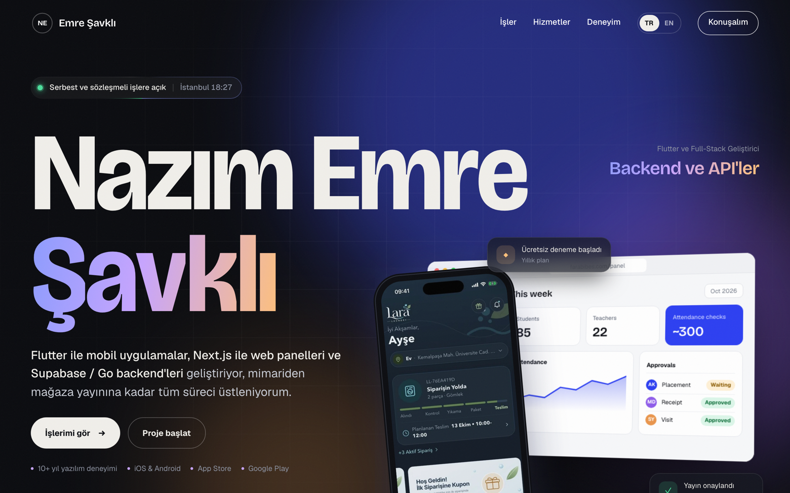

# Emre Şavklı — Portfolyo

<p align="center"></p>

Flutter ve full-stack geliştirici Nazım Emre Şavklı'nın kişisel portfolyo sitesi ve sitenin içeriğini kod yazmadan yönettiği yönetim paneli.

- **Site:** Tek sayfalık, Türkçe/İngilizce portfolyo. Seçili işler (çoklu ekran görüntüsü geçişli proje kartları), teknoloji katmanları haritası, hizmetler, çalışma süreci, deneyim ve proje talep formu.
- **Panel (`/admin`):** Projeler, metinler, görseller, iletişim mesajları, raporlar ve site ayarları. Kaydedilen her şey Supabase'e yazılır ve site aynı veriyi okur.

## Stack

| Katman | Kullanılan |
|---|---|
| Site | Statik HTML/CSS + vanilla JS (build adımı yok), GSAP + ScrollTrigger, Lenis |
| Panel | Vanilla ES modülleri: hash router, servis katmanı, adapter deseni |
| Veri | Supabase (PostgreSQL + Row Level Security, Auth, Storage) |
| Yayın | Vercel (statik) |
| Yerel geliştirme | `python3 -m http.server`, Supabase CLI + Docker |

Supabase bağlı değilken site `content.js` içindeki varsayılan içerikle çalışır, panel de girişsiz **demo modunda** açılır (veri yalnızca o tarayıcıda tutulur).

## Klasör yapısı

```
index.html, app.js        Herkese açık site
content.js                Varsayılan içerik + teknoloji kataloğu (Supabase yokken kullanılır)
config.js                 Supabase adresi ve anon anahtarı (repoda boş)
admin/                    Yönetim paneli (ayrıntılar: admin/README.md)
admin-legacy.html         Eski tek dosyalık panel (yedek)
supabase/
  migrations/             Şema, RLS kuralları, site_payload() fonksiyonu
  seed.sql                Sitenin bugünkü içeriği (scripts/gen-seed.mjs ile üretilir)
  scripts/                Seed üretici ve yerel geliştirme yardımcıları
  config.toml             Yerel Supabase ayarları
media/, fonts/, vendor/   Görseller, yazı tipleri, üçüncü parti kütüphaneler
vercel.json               Temiz URL'ler, başlıklar, /admin için noindex
```

## Yerelde çalıştırma

**Demo modu (kurulum gerektirmez):**

```bash
python3 -m http.server 5173
```

- Site: http://localhost:5173
- Panel: http://localhost:5173/admin/ (girişsiz, demo verisiyle)

**Yerel Supabase ile (gerçek giriş, RLS, Storage):** Docker ve [Supabase CLI](https://supabase.com/docs/guides/cli) gerekir.

```bash
supabase start                                  # migration'lar + seed (portlar 5442x)
node supabase/scripts/local-admin.mjs           # yerel admin hesabı; şifre .env.local'e yazılır
node supabase/scripts/local-config.mjs on       # config.js → yerel Supabase
python3 -m http.server 5173
```

> Commit etmeden önce `node supabase/scripts/local-config.mjs off` çalıştır; `config.js` yerel değerlerle commit'lenmemeli.

## Canlıya alma (özet)

1. Supabase'de bir proje aç, kendi kullanıcını oluştur ve yeni kayıtları kapat.
2. SQL Editor'da sırasıyla `supabase/migrations/` altındaki iki dosyayı ve `supabase/seed.sql`'i çalıştır, sonra hesabını `admins` tablosuna ekle.
3. Project URL ve **anon public** anahtarını `config.js`'e yaz.
4. Vercel'e deploy et. Panel `/admin` adresinde açılır.

Adım adım anlatım: [`admin/README.md`](admin/README.md). Proje formu e-posta bildirimi ve SEO notları: [`KURULUM.md`](KURULUM.md).

## Güvenlik

- Tarayıcıda yalnızca Supabase **anon** anahtarı kullanılır. Bu anahtar herkese açık olacak şekilde tasarlanmıştır ve veriyi RLS kuralları korur. `service_role` anahtarı hiçbir dosyada bulunmaz.
- **Ziyaretçiler:** Yalnızca yayındaki içeriği okuyabilir ve iletişim formundan mesaj ekleyebilir. Mesajları okuyamazlar. Form için e-posta başına 10 dakikada en fazla 3 mesaj sınırı vardır.
- **Yazma yetkisi:** Yalnızca `admins` tablosundaki hesaplarda. Yeni kayıt açmak kapalıdır.
- **Yerel değerler:** `.env.local` yalnızca yerel geliştirme içindir ve `.gitignore` ile `.vercelignore` tarafından dışarıda tutulur.
